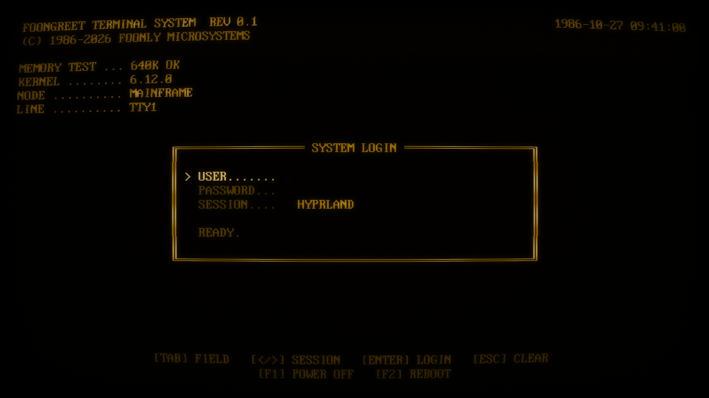
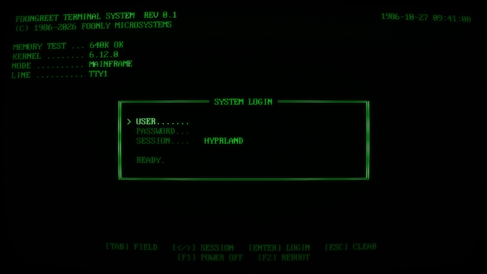

# foongreet

A greetd greeter that draws straight to DRM/KMS (or `/dev/fb0`) with a
software CRT effect in amber or green phosphor. No compositor, no GPU
stack.

## Build and install

    make                 # build as your user
    sudo make install    # greeter and screen locker

This builds and installs both the greeter and the
[screen locker](#screen-locker). To do just the greeter, use
`make greeter` and `sudo make install-greeter`.

`make install-greeter` puts the binary in `/usr/local/bin`, installs
`config.example.toml` as `/etc/foongreet/config.toml` unless one already
exists, and creates `/var/cache/foongreet` for the `greeter` user.
`PREFIX`, `DESTDIR` and `GREETER_USER` can be overridden as usual.
`sudo make uninstall` removes the binaries but keeps the config and cache.

Other targets: `make test`, `make preview` (desktop window with a fake
greetd), `make screenshots` (regenerates the images above).

## Trying it out

1. **Desktop preview** (fake greetd, password is `password`):

       make preview

   `foongreet --snapshot out.png` renders offscreen instead; add `--demo`
   to swap your hostname, kernel, memory and clock for made-up values
   (`make screenshots` uses both).

2. **Spare VT with the real display path**: switch to a free VT
   (Ctrl+Alt+F3), log in, and run:

       ./target/release/foongreet --mock

   Ctrl+C quits in mock mode (or with `--dev`).

   To exercise the real IPC path, run it under greetd's `fakegreet`
   (`cargo install --git https://git.sr.ht/~kennylevinsen/greetd fakegreet`):

       fakegreet "./target/release/foongreet --dev" > fakegreet.log 2>&1

   Log in as `user` / `password`, then answer `9` to `7 + 2`.

   To try settings without touching `/etc`, pass `--config my.toml`.

3. **For real**: after `sudo make install`, set the greeter in
   `/etc/greetd/config.toml`:

       [default_session]
       command = "/usr/local/bin/foongreet"
       user = "greeter"

   Settings go in `/etc/foongreet/config.toml` (see below). Keep your previous `command` line commented out, and make sure you
   can still get a root shell on another VT.

## Configuration

Settings are read from `/etc/foongreet/config.toml`; every key is
optional. `config.example.toml` lists them all with their defaults:
phosphor color, background image, font, login screen, `/dev/fb0` mode,
default user, cache directory, power commands and extra sessions.

With several screens, the login goes on one (`output`, default the first
connected) and the others show an empty tube. A laptop panel under a
closed lid is skipped and turned off. F3 moves the login to the next
screen and F4 turns it a quarter turn, for monitors standing on their
side. Both are remembered at the next login: the screen for that set of
monitors, the rotation for that monitor (recognized by its EDID, so a
dock renumbering connectors doesn't matter). A remembered screen wins
over `output`. `foongreet --list-outputs` shows the screen names and
which one gets the login by default; it works while your compositor is
running.

A broken config does not stop the greeter: it starts with the defaults,
shows `CONFIG ERROR, USING DEFAULTS`, and writes the details to stderr.
A missing image or font is handled the same way. To see the details,
run `foongreet --snapshot /tmp/x.png` against the config.

The command line only has testing flags; see `foongreet --help`.

## Screen locker

`foonlock` locks a Wayland session with the same look, through
ext-session-lock-v1 (Hyprland, sway, niri, river, KWin and others).
It checks the password with PAM and reads the `[display]` settings from
the same config file. `make` and `sudo make install` include it; to
build and install only the locker (it needs libpam, libxkbcommon and
libsystemd):

    make lock
    sudo make install-lock    # binary and /etc/pam.d/foonlock

Then start it from hypridle (`~/.config/hypr/hypridle.conf`):

    general {
        lock_cmd = pidof foonlock || foonlock
        before_sleep_cmd = loginctl lock-session
        inhibit_sleep = 3
    }

`inhibit_sleep = 3` makes hypridle hold off a suspend until the session
is actually locked (it disables `on_lock_cmd` and `on_unlock_cmd`).

With several screens, the lock box goes to the one the mouse is on
(at first the `output` from the config) and the others show an empty
tube; moving the mouse to another screen takes the box along. Portrait
screens work too.

`foonlock` refuses to start without `/etc/pam.d/foonlock`, as PAM's
fallback would deny every password and the session could not be
unlocked. If it ever dies while locked, the compositor keeps the session
locked; in Hyprland, set `misc:allow_session_lock_restore` so a new
locker can take over: start `foonlock` again from another VT with
`WAYLAND_DISPLAY` and `XDG_RUNTIME_DIR` pointing at the session.

To try it out without PAM, `foonlock --mock` takes the password
`password`, and `--unlock-after SECS` unlocks by itself.

### Suspend

A screen keeps its last frame while suspended and shows it again on
resume, so `foonlock` makes sure that frame is black:

- While locked it holds a logind sleep delay inhibitor. When logind
  announces a suspend, every screen goes black and the inhibitor is
  released once they show it (after at most 0.5 s).
- Started for the suspend itself (`before_sleep_cmd`), it begins with
  a second of black before the power-on, which is where the suspend
  lands.
- After resume the tube powers on again, as at the start.

If closing the lid right after a resume does nothing, that is logind,
not the locker: it ignores the lid for `HoldoffTimeoutSec` (30 s) after
boot or resume, so that docking monitors are detected first, and only
then checks the lid again. To shorten it:

    sudo mkdir -p /etc/systemd/logind.conf.d
    printf '[Login]\nHoldoffTimeoutSec=10s\n' | sudo tee /etc/systemd/logind.conf.d/holdoff.conf

This takes effect after a reboot. Too short, and closing the lid while
docked may suspend before the external monitors are back.

### Idle

After 25 s without input, the greeter and the locker go still: the
cursor stops blinking, the flicker and rolling bar pause, and the
screen is only redrawn when the clock ticks. Any key wakes them.

## Wallpaper

`foonpaper` turns an image into a matching desktop wallpaper: low
resolution, one phosphor color, scanlines and glow, but on a flat screen
without the tube's curvature:

    foonpaper --size 2560x1440 --phosphor amber in.png out.png

Give portrait screens as `1440x2560`; `--dim` sets the brightness
(default 0.5). `--gradient "#0d0820,#ff3d9a,#ffb86c"` maps the image
through colors from dark to bright instead of a phosphor. It is built and installed with the rest, or alone with
`make paper` and `sudo make install-paper`.

## License

Copyright (C) 2026 Niklas Schönberg

foongreet is free software: you can redistribute it and/or modify it
under the terms of the GNU General Public License as published by the
Free Software Foundation, either version 3 of the License, or (at your
option) any later version. See [LICENSE](LICENSE).
