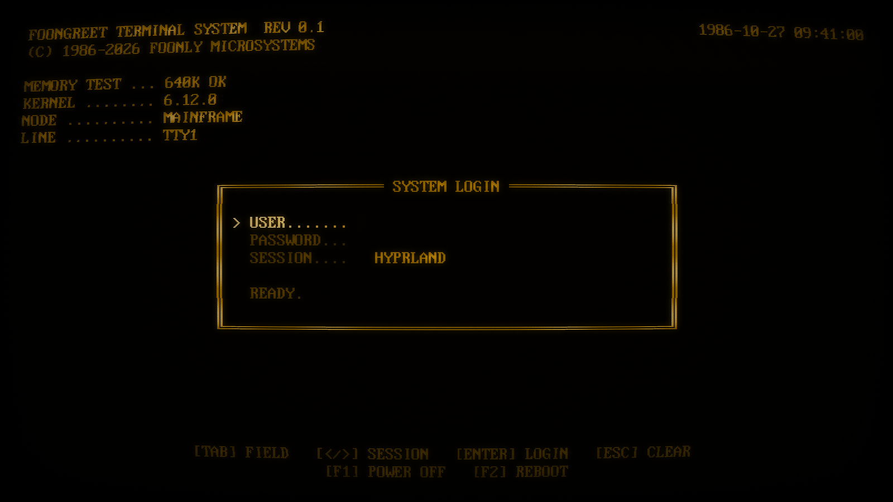
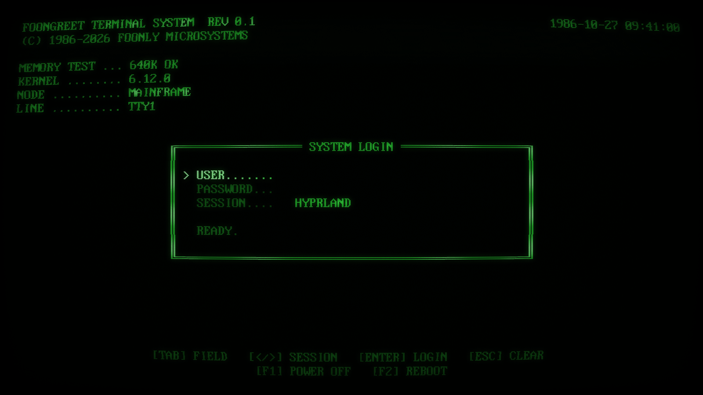

# foongreet

A greetd greeter that draws straight to DRM/KMS (or `/dev/fb0`) with a
software CRT effect in amber or green phosphor. No compositor, no GPU
stack.

## Build

    cargo build --release                      # greeter binary
    cargo build --release --features preview   # + desktop preview window

## Trying it out

1. **Desktop preview** (fake greetd, password is `password`):

       cargo run --release --features preview -- --preview 1600x900

   `--snapshot out.png` renders offscreen instead; add `--demo` to swap
   your hostname, kernel, memory and clock for made-up values. The
   screenshots above are:

       foongreet --snapshot docs/amber.png --preview 1600x900 --config /dev/null --demo

   (and the same with a config containing `phosphor = "green"`).

2. **Spare VT with the real display path**: switch to a free VT
   (Ctrl+Alt+F3), log in, and run:

       ./target/release/foongreet --mock

   Ctrl+C quits in mock mode (or with `--dev`).

   To exercise the real IPC path, run it under greetd's `fakegreet`
   (`cargo install --git https://git.sr.ht/~kennylevinsen/greetd fakegreet`):

       fakegreet "./target/release/foongreet --dev" > fakegreet.log 2>&1

   Log in as `user` / `password`, then answer `9` to `7 + 2`.

   To try settings without touching `/etc`, pass `--config my.toml`.

3. **For real** (`/etc/greetd/config.toml`):

       [default_session]
       command = "/usr/local/bin/foongreet"
       user = "greeter"

   Settings go in `/etc/foongreet/config.toml` (see below). To remember
   the last user and session, create the cache directory for the greeter
   user once:

       sudo install -d -o greeter -g greeter -m 700 /var/cache/foongreet

   Keep your previous `command` line commented out, and make sure you
   can still get a root shell on another VT.

## Configuration

Settings are read from `/etc/foongreet/config.toml`; every key is
optional. `config.example.toml` lists them all with their defaults:
phosphor color, background image, font, login screen, `/dev/fb0` mode,
default user, cache directory, power commands and extra sessions.

With several screens, the login goes on one (`output`, default the first
connected) and the others show an empty tube. `foongreet --list-outputs`
shows the screen names and which one gets the login; it works while your
compositor is running.

A broken config does not stop the greeter: it starts with the defaults,
shows `CONFIG ERROR, USING DEFAULTS`, and writes the details to stderr.
A missing image or font is handled the same way. To see the details,
run `foongreet --snapshot /tmp/x.png` against the config.

The command line only has testing flags; see `foongreet --help`.
